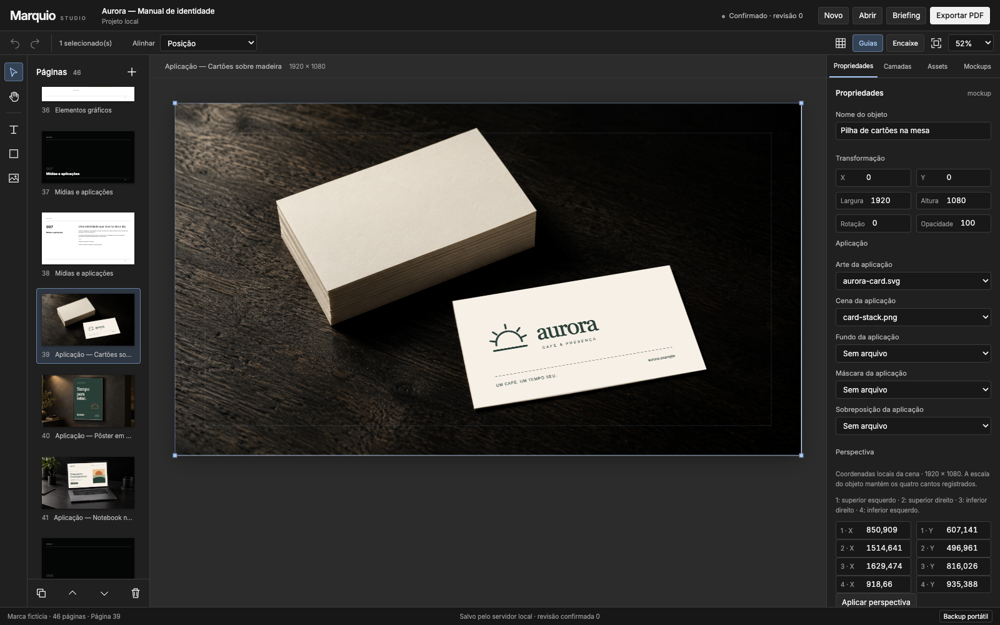

# Marquio

Monte um manual com os materiais de identidade que você tem e finalize no Studio editável. Pule seções que não se aplicam, revise sugestões, ajuste os objetos e exporte o PDF da revisão confirmada.

O fluxo principal roda localmente, sem conta. Codex e Claude Code abrem o mesmo aplicativo e formato de projeto. [English guide](README.md).



[Fluxo real no Studio](docs/assets/studio-walkthrough.gif) · [PDF de exemplo](examples/Aurora.pdf) · [Projeto editável](examples/Aurora.marquio.zip)

## Executar

Requisitos: **Node.js 22+**, npm e Chromium. Instale o Chromium do Playwright ou defina `MARQUIO_CHROMIUM_EXECUTABLE` com o caminho absoluto do Chrome/Chromium. No Linux, `npx playwright install --with-deps chromium` instala também as bibliotecas do sistema. Os testes de extração de texto do PDF precisam de Poppler (`pdftotext`). Ainda não há pacote publicado no npm; instale a partir do repositório.

```bash
git clone https://github.com/higormanoel/brand-manual-pdf.git
cd brand-manual-pdf
npm ci
npx playwright install chromium
npm run build
node bin/marquio.mjs studio ./minha-marca --name "Minha marca"
```

Mantenha o terminal aberto. O servidor usa `127.0.0.1`, escolhe uma porta disponível e abre/imprime a URL da sessão atual. Essa URL contém uma credencial local; não a compartilhe. Use Ctrl+C para encerrar. Reabra a mesma pasta para continuar.

```bash
node bin/marquio.mjs studio ./aurora-demo --demo
```

Aurora é uma torrefação e café fictícios. Textos, identidade e ilustrações são originais. As três cenas fotográficas geradas para o produto têm [prompts e procedência](public/mockups/PROVENANCE.md), com arte aplicada em camada separada. São composições de apresentação, sem representar a produção real de um cliente. Não exigem geração paga.

## Abrir o exemplo pronto

O [PDF Aurora](examples/Aurora.pdf) tem 46 páginas, exportadas da revisão confirmada 0. O [projeto portátil](examples/Aurora.marquio.zip) inclui os 11 assets originais. Abra-o pelo menu de projeto do Studio para editar no modo navegador, ou gere uma cópia local nova:

```bash
node examples/create-demo.mjs ./marquio-demo-output
node bin/marquio.mjs studio ./marquio-demo-output/aurora
```

O helper usa a CLI de produção e a API local de exportação, recusando sobrescrever um exemplo existente. Veja [procedência e reprodução](examples/README.md), [desktop estreito](docs/assets/studio-narrow.png) e [prévia no celular](docs/assets/studio-mobile.png).

## Do briefing à entrega

1. Preencha os campos que quiser, importe logos/fontes e selecione as seções. Uma seção pulada continua pulada. Regras, dados e créditos vêm do designer.
2. Gere páginas editoriais. Sugestões ficam pendentes até sua aprovação. A identidade do cliente e o sistema editorial têm configurações separadas.
3. Edite textos, imagens, formas, grupos, camadas e aplicações. Revise quebras de texto, substituições de fontes e mockups no Studio real. Títulos, regras, números e créditos são objetos editáveis.
4. Aguarde a confirmação de salvamento, revise as páginas e exporte o PDF. Baixe também o projeto portátil: ele é a fonte editável da entrega.

No modo local, o servidor grava a pasta do projeto. `project.marquio.json` é a base imutável; revisões posteriores ficam em `commits/`. Não edite esses arquivos manualmente: CLI, Studio e exportador usam o repositório para resolver a revisão atual. Copie a pasta completa ou transfira um backup portátil com os bytes dos assets. Regenerar adiciona uma variante e preserva estados anteriores; substituições intencionais exigem revisão e páginas esperadas.

O modo somente navegador usa IndexedDB, backup portátil e impressão do navegador. A recuperação pertence à **origem e porta**: outra porta não recupera as pendências da anterior. Transfira esse trabalho por backup portátil. O exportador PDF validado depende do servidor local.

## Instalar nos agentes

Depois do build, escolha explicitamente a raiz do projeto:

```bash
node bin/marquio.mjs install --agent codex --target "/caminho/do/trabalho"
node bin/marquio.mjs install --agent claude --target "/caminho/do/trabalho"
```

Codex usa `.agents/skills/marquio` e `$marquio`; Claude Code usa `.claude/skills/marquio` e `/marquio`. Para instalar pessoalmente, passe `--target "$HOME"`. Uma instalação existente é preservada; `--force` substitui apenas a pasta dessa skill. O launcher referencia este checkout/build, funciona com espaços e em outro diretório. Mantenha o repositório, refaça o build após atualizar e reinstale se o mover. Não altera autenticação nem instala pacotes globais do npm.

Os caminhos seguem as documentações oficiais de [Codex](https://learn.chatgpt.com/docs/build-skills) e [Claude Code](https://code.claude.com/docs/en/skills), consultadas em 15/10/2026. Os adaptadores preservam omissões e sugestões pendentes, usam revisão confirmada e abrem o Studio antes da entrega final. Geração externa é opcional e depende de um provedor disponível escolhido pelo usuário ou de um resultado importado. Templates, cenas e prompts incluídos funcionam sem essa conta.

## CLI

```bash
node bin/marquio.mjs --help
node bin/marquio.mjs validate ./minha-marca --json
node bin/marquio.mjs import-asset ./minha-marca ./logo.svg --revision 0 --command-id logo-1
node bin/marquio.mjs apply ./minha-marca --batch ./alteracoes.json
node bin/marquio.mjs generate ./minha-marca --command-id editorial-1
node bin/marquio.mjs export ./minha-marca --output ./manual.pdf --revision 3
```

Use a revisão realmente retornada; os números acima são exemplos. Lotes usam `commandId`, `expectedRevision` e comandos do [schema](src/core/commands.ts), com IDs reais. Importar um asset confirma uma nova revisão. Em conflito, recarregue e reconcilie. O PDF usa um snapshot da revisão solicitada, independente de alterações posteriores.

## Limites e desenvolvimento

Não há suporte a PSD, CMYK, PDF/X ou todas as ferramentas do Photoshop. O produto não vem conectado a um provedor de geração. Fontes ausentes geram diagnóstico; arquivos de fontes do cliente precisam da licença apropriada. Inter é distribuída sob [SIL OFL](public/licenses/Inter-OFL.txt). O armazenamento requer filesystem local com hard links exclusivos e sincronização de diretórios, sem protocolo de colaboração distribuída nem limpeza automática do histórico.

```bash
npm run typecheck
npm run build
npm test
npm run test:e2e
npm pack --dry-run
```

Faça o build antes da suíte completa: testes de PDF e launchers usam o app compilado. Consulte [contribuição](CONTRIBUTING.md), [segurança](SECURITY.md), [histórico](CHANGELOG.md) e [licenças](THIRD_PARTY_NOTICES.md).

A [skill legada](legacy/SKILL.md), o [template HTML](assets/template_brand_manual.html) e o [script PDF](scripts/generate_pdf.sh) foram preservados. Checkouts instalados anteriormente não são alterados automaticamente. As novas instalações usam o Studio editável. A URL do repositório continua `higormanoel/brand-manual-pdf`.
